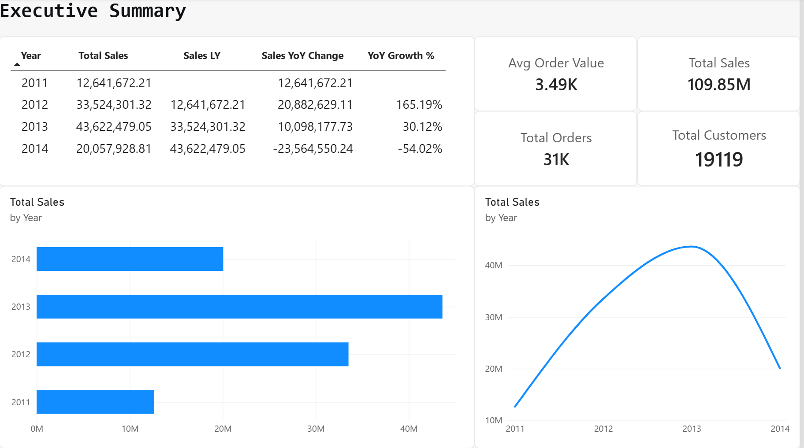
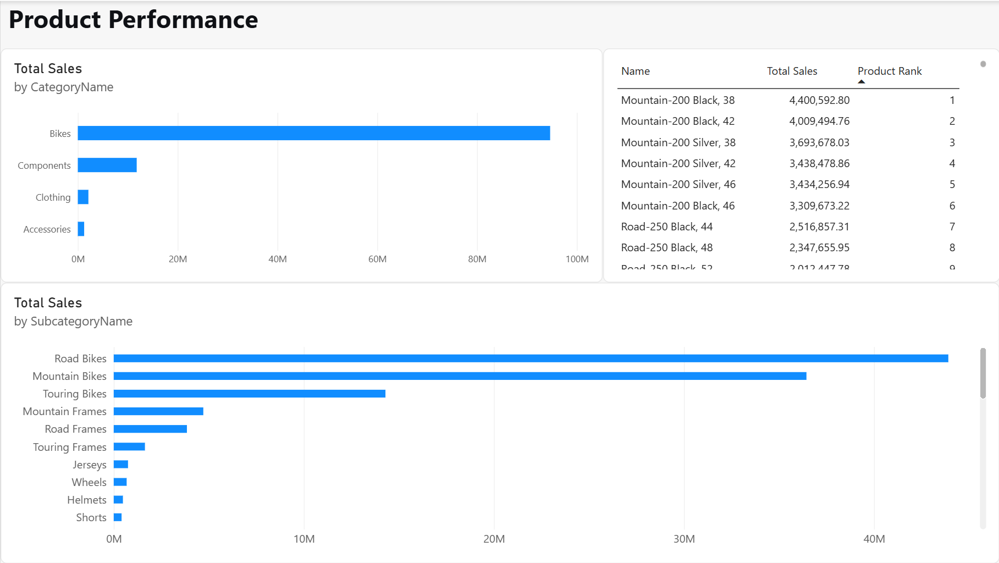
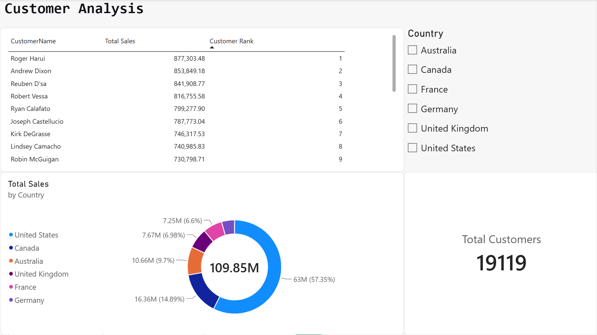

# AdventureWorks Sales Dashboard (Power BI)

An end-to-end Power BI report built on **AdventureWorks OLTP** data — covering data cleaning in Power Query, semantic model design, DAX measures, drill-down hierarchies, and Row-Level Security.

This report pulls directly from the OLTP source and performs all transformation in Power Query, demonstrating a full BI development workflow.

> **Note:** This folder contains two Power BI files. `AdventureWorks_advanced.pbix` is the final report — built from OLTP source with Power Query transformations, semantic model, DAX measures, drill-down, and RLS. `AdventureWorks_simple.pbix` is an earlier version built directly on the pre-cleaned SQL Server DW, kept for reference.

---

## Tech Stack

| Layer | Technology |
|-------|-----------|
| Source | SQL Server (AdventureWorks2019 OLTP) |
| Data Transformation | Power Query (M) |
| Semantic Model | Star schema — 1 fact + 3 dimensions |
| Measures | DAX (11 measures) |
| Visualisation | Power BI Desktop |
| Security | Row-Level Security (RLS) |
| Version Control | GitHub |

---

## Data Model

The model is a star schema with FactSales at the centre and three dimensions around it.

- **FactSales** connects to **DimProduct** on ProductID
- **FactSales** connects to **DimCustomer** on CustomerID
- **FactSales** connects to **DimDate** on OrderDate

| Table | Type | Grain | Rows |
|-------|------|-------|-----:|
| FactSales | Fact | Order line | 121,317 |
| DimProduct | Dimension | Product | 504 |
| DimCustomer | Dimension | Customer | 19,820 |
| DimDate | Dimension | Date (2011-2014) | 1,461 |

### Relationships

| From | To | Cardinality | Cross filter |
|------|----|:-----------:|:------------:|
| FactSales[ProductID] | DimProduct[ProductID] | Many-to-one | Single |
| FactSales[CustomerID] | DimCustomer[CustomerID] | Many-to-one | Single |
| FactSales[OrderDate] | DimDate[FullDate] | Many-to-one | Single |

---

## Power Query Transformations

All transformation was done in Power Query, sourcing directly from the OLTP database.

| Transformation | Purpose |
|---------------|---------|
| Reference queries | Keep raw tables intact; build cleaned versions separately |
| Column selection | Reduce data volume; keep only analytical columns |
| Type conversion | Dates, integers, decimals as appropriate |
| Null filtering | Removed records with null CustomerID |
| Merge queries | Combined SalesOrderHeader and SalesOrderDetail into FactSales |
| Snowflake-to-star | Flattened Product, ProductSubcategory and ProductCategory into one DimProduct |
| Custom column | Derived CustomerType (Individual / Store) |
| Merge with Person | Enriched DimCustomer with customer name |
| Merge with Territory and CountryRegion | Enriched DimCustomer with TerritoryName and Country |
| Generated DimDate | Built date dimension covering 2011-01-01 to 2014-12-31 |

See [power-query-m.md](power-query-m.md) for the full M code.

---

## DAX Measures

11 measures across four categories: basic, time intelligence, ranking, and ratio.

See [dax-measures.md](dax-measures.md) for the full list with formulas.

| Category | Measures |
|----------|----------|
| Basic | Total Sales, Total Orders, Total Customers, Avg Order Value |
| Time Intelligence | Sales LY, YoY Growth %, Sales YTD, Sales MTD |
| Ranking | Product Rank, Customer Rank |
| Ratio | Sales % of Total |

---

## Report Pages

### Page 1 - Executive Summary

- 4 KPI cards: Total Sales, Total Orders, Total Customers, Avg Order Value
- Year-over-year comparison table (Total Sales, Sales LY, YoY Change, YoY Growth %)
- Sales trend line chart with date hierarchy drill-down (Year, Quarter, Month, Day)
- Year slicer

### Page 2 - Product Performance

- Sales by category (bar chart)
- Sales by subcategory (bar chart)
- Top products by sales (table with Product Rank)

### Page 3 - Customer Analysis

- Top 20 customers by sales (table with Customer Rank)
- Country slicer
- Total Customers KPI card
- Sales by country (donut chart)

---

## Features Demonstrated

| Feature | Where |
|---------|-------|
| Power Query cleaning | All 4 tables transformed from OLTP |
| Snowflake-to-star flattening | DimProduct — 3 source tables merged into 1 |
| Surrogate relationship modelling | FactSales with 3 dimensions |
| Date hierarchy | DimDate: Year, Quarter, MonthName, Day |
| Drill-down | Used in Page 1 line chart |
| Time intelligence DAX | Sales LY, YoY Growth %, Sales YTD, Sales MTD |
| Ranking DAX | Product Rank, Customer Rank (RANKX) |
| Ratio DAX | Sales % of Total (with ALL) |
| Row-Level Security | Roles: Australia Only, Germany Only |
| Data quality validation | Row counts reconciled against source |

---

## Data Validation

All row counts were reconciled against the source OLTP database:

| Table | OLTP | Power BI | Match |
|-------|-----:|---------:|:-----:|
| FactSales | 121,317 | 121,317 | Yes |
| DimProduct | 504 | 504 | Yes |
| DimCustomer | 19,820 | 19,820 | Yes |
| DimDate | 1,461 | 1,461 | Yes |

---

## Row-Level Security

Two roles were defined on the DimCustomer[Country] column:

| Role | DAX filter | Scope |
|------|-----------|-------|
| Australia Only | [Country] = "Australia" | Australian customers only |
| Germany Only | [Country] = "Germany" | German customers only |

Validated using Modeling -> View as roles.

---

## How to Open

1. Clone this repository
2. Open AdventureWorks.pbix in Power BI Desktop
3. If prompted, update the SQL Server data source to point to your own AdventureWorks2019 instance
4. Click Refresh to reload data

---

## Author

Yonggang Chen (Eddie)
eddiechannz@gmail.com

GitHub: https://github.com/Yonggang-Chen-1173486