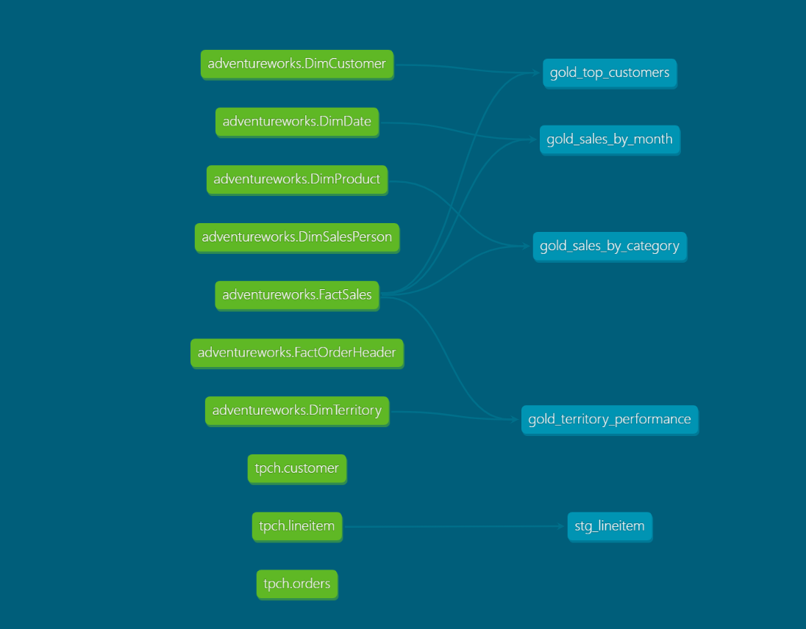

# AdventureWorks dbt Project

A dbt project that rebuilds the Gold layer of the AdventureWorks data warehouse using SQL models — replacing the equivalent PySpark transformations with a managed, tested, and documented dbt pipeline.

This project demonstrates the modern ELT pattern: data is loaded into the lakehouse (Bronze/Silver) and then transformed using dbt on Databricks SQL Warehouse.

---

## Tech Stack

| Layer | Technology |
|-------|-----------|
| Source (Silver) | Delta Lake tables in Unity Catalog (`adb_adventureworks_dw.default`) |
| Transformation | dbt Core with `dbt-databricks` adapter |
| Compute | Databricks SQL Warehouse |
| Target (Gold) | Delta Lake tables in `adb_adventureworks_dw.adventureworks_dbt_gold` |
| Version Control | Git |

---

## Why dbt

The Gold layer was previously built with PySpark notebooks. This project rebuilds it with dbt to demonstrate the advantages of a modern transformation framework:

| Capability | PySpark Version | dbt Version |
|-----------|:---:|:---:|
| Transformation logic | Notebooks | SQL files |
| Dependency management | Manual | Automatic (via `ref()` and `source()`) |
| Data quality tests | Manual SQL checks | Declarative YAML tests |
| Documentation | Manually written | Auto-generated |
| Lineage graph | Manually drawn | Auto-generated |
| Version control | Notebook export | Native Git |

Both versions produce the same output — but dbt adds engineering rigour with less effort.

---

## Sources

The following Silver-layer tables are declared as dbt sources:

| Source | Table |
|--------|-------|
| `adventureworks` | FactSales |
| `adventureworks` | DimProduct |
| `adventureworks` | DimCustomer |
| `adventureworks` | DimDate |
| `adventureworks` | DimTerritory |

---

## Models

All models are materialised as tables in the `gold` schema.

| Model | Description |
|-------|-------------|
| `gold_sales_by_category` | Sales aggregated by product category and subcategory |
| `gold_sales_by_month` | Sales aggregated by year and month |
| `gold_top_customers` | Customer sales with ranking by total sales |
| `gold_territory_performance` | Sales aggregated by territory |

---

## Data Tests

Each model has declarative data tests defined in `schema.yml`:

| Test Type | Applied To |
|-----------|-----------|
| `not_null` | Key columns in all models |
| `accepted_values` | Month number (1 to 12) in `gold_sales_by_month` |

Run tests with:

    dbt test

---

## Lineage Graph

The lineage graph shows the flow from Silver sources to Gold models. It is generated automatically by dbt from the `source()` and `ref()` references in the SQL files.

---

## How to Run

1. Clone this repository
2. Install dbt-databricks:

       pip install dbt-databricks

3. Configure `profiles.yml` with your Databricks connection (host, http_path, token, catalog, schema)
4. From the project directory, run:

       dbt debug
       dbt run
       dbt test
       dbt docs generate
       dbt docs serve

---

## Project Structure

    08-dbt/
    ├── README.md
    ├── dbt_project.yml
    ├── models/
    │   └── marts/
    │       ├── sources_adventureworks.yml
    │       ├── schema.yml
    │       ├── gold_sales_by_category.sql
    │       ├── gold_sales_by_month.sql
    │       ├── gold_top_customers.sql
    │       └── gold_territory_performance.sql
    └── screenshots/
        └── lineage-graph.png

---

## Notes

- `profiles.yml` is not committed — it contains the Databricks access token.
- `target/` and `logs/` are not committed — they are build artefacts.
- The Gold layer is created in the schema `adventureworks_dbt_gold` — dbt prefixes the custom schema with the target schema by default.

---

## Author

Yonggang Chen (Eddie)
eddiechannz@gmail.com

GitHub: https://github.com/Yonggang-Chen-1173486